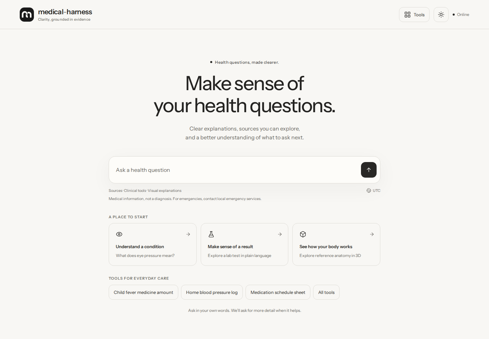

# medical-harness

Ask a health question and get an evidence-grounded answer with source articles. medical-harness combines a FastAPI agent, clinical calculators, and an interactive 3D anatomy viewer in a single web application.

[How it works](docs/ARCHITECTURE.md) · [Tools and reliability](docs/RELIABILITY.md) · [Evaluation loop](docs/EVALUATION.md) · [Research decisions](docs/RESEARCH.md)

> medical-harness provides educational information, not a diagnosis or a substitute for a clinician. For emergencies, contact local emergency services.



[Desktop and mobile screenshots](docs/VISUALS.md)

## What you can do

- Adjust your time zone and optional country using the globe button beside the question box.
- Ask a question in plain language and follow up in the same conversation.
- Read an answer linked to medical source articles. If retrieval fails, the agent does not invent supporting sources.
- Use adult BMI, CKD-EPI 2021 eGFR, estimated average glucose, measurement conversion, Wells DVT, CHA2DS2-VASc, and MRC muscle strength tools; see their [scope and limitations](docs/RELIABILITY.md) .
- Find official US medicine label links and PubMed-indexed research abstracts when relevant.
- Hand a summary to a clinician: open **Hand this to a clinician** under any answer, follow-up, emergency notice, or error to copy, print, or download your own words, calculator inputs, sources, limits, and three questions to ask. Nothing is stored or emailed.
- See how an answer was made: a collapsible panel lists each step, its status, and which retrieved sources the answer cited. This is coverage, not verification of each claim.
- Read official US label sections (boxed warning, indications, contraindications, warnings, adverse reactions) for a named medicine, and calculate pack-years and waist-to-height ratio from numbers you supply.
- Calculate non-HDL cholesterol from total and HDL values on the same lipid panel, in matching mg/dL or mmol/L units, without assigning a risk category.
- Open a focused 3D reference scene when a spatial explanation helps the question. General questions download no 3D assets.
- Explore sourced visual explanations of eye pressure, asthma, reflux, kidney stones, gallstones, joint changes, discs, and arterial plaque when relevant. These compare mechanisms rather than simulate your body.
- Understand the sections of a written X-ray, CT, MRI, or ultrasound report. Paste relevant wording without personal identifiers; the app cannot inspect scan images.
- Explore what blood pressure's two numbers mean and what an ECG records. The illustrations do not classify a personal reading or interpret a tracing.
- Open the visual-guide button above a relevant answer to see its interactive illustration. For example, ask “Show a simple explanation of P, QRS and T on an ECG,” then select **Explore an ECG signal**.

- Switch between light and dark themes on desktop or mobile. Try asking “How does eye pressure work?” or “Where is the kneecap and how does it move?”
## Run locally

You need Python 3.12 or newer, [uv](https://docs.astral.sh/uv/getting-started/installation/), and API keys from [Cerebras Cloud](https://inference-docs.cerebras.ai/console/api-keys) and [MediSearch Developers](https://medisearch.io/developers/docs). The keys belong to those services; Vercel does not provide them. DailyMed and Europe PMC lookups need no additional key.

```bash
git clone https://github.com/ompathak2004/Medical-Harness.git
cd Medical-Harness
uv sync --locked
```

Copy the example configuration and fill in the two required keys:

```bash
cp .env.example .env
```

On Windows PowerShell, use `Copy-Item .env.example .env`.
Environment variables set in your shell override values in `.env`.

Set `CEREBRAS_API_KEY` and `MEDISEARCH_API_KEY` in `.env`, then start the app:
Missing or empty provider keys cause a settings validation error at startup.

```bash
uv run medical-harness
```

Refreshing the page clears the current conversation; the app has no durable conversation history.

Open <http://localhost:8080>. Check <http://localhost:8080/api/health> if the page does not load. The interactive API reference is at <http://localhost:8080/docs>.

If port 8080 is busy, set `PORT=8081` in `.env`, restart the app, and open <http://localhost:8081>.

The `.env` file is ignored by Git. Do not commit keys or put them in screenshots, issues, or pull requests. Tests use fake keys and do not call the paid APIs.

### Docker

```bash
docker build -t medical-harness .
docker run --env-file .env -p 8080:8080 medical-harness
```

## Repository map

| Path | Purpose |
| --- | --- |
| `app/main.py` | FastAPI app, middleware, lifecycle, static frontend |
| `app/api/routes.py` | Chat, streaming chat, health, and metrics routes |
| `app/pipeline.py` | Triage, retrieval, calculators, generation, safety review |
| `app/prompts.py` | LLM instructions and output formats |
| `app/llm.py`, `app/evidence.py` | Cerebras and MediSearch clients |
| `app/tools/` | Validated calculators, reference lookups, and anatomy selection |
| `static/` | Browser UI, styles, scripts, and licensed anatomy assets |
| `tests/` | Offline API/pipeline tests and real-browser UI tests |
| `evals/` | Synthetic live evaluations and an offline comparison gate |
| `docs/` | Architecture, API, deployment, and visual walkthrough |

Read [the architecture guide](docs/ARCHITECTURE.md) for the request flow and the [API guide](docs/API.md) for example requests and streaming events. [AGENTS.md](AGENTS.md) is the short working map for coding agents.

See [CONTRIBUTING.md](CONTRIBUTING.md) for the development workflow and pull request guidelines.

## Develop

```bash
uv sync --locked
uv run pytest -q
uv run ruff check app tests evals
npm ci --ignore-scripts
npx playwright install chromium
npm run build
npm run check:anatomy
npm run test:browser
```
Windows browser tests use installed Google Chrome. Linux and macOS use Playwright Chromium.

The app has no built-in user authentication; review the [deployment](docs/DEPLOYMENT.md) and [security](SECURITY.md) guidance before publishing it.
For UI changes, check desktop and mobile widths, both themes, keyboard navigation, and reduced-motion behavior.

Commit rebuilt `static/dist/` and `static/build.json` alongside frontend source changes.

Stop any existing development server on port 8080 before browser tests so Playwright starts its fake-key test server.

Node 22+ is needed only to change or test the frontend. Self-hosted bundles and regional GLBs are checked in, so Python deployments do not need npm. Playwright always starts an isolated local test server with fake provider keys. CI runs Python checks and browser checks in parallel, caches locked dependencies, and cancels superseded runs. It rejects stale or untracked bundles. Optional live evaluations require `--live`; see [the evaluation guide](docs/EVALUATION.md).

## Deploy

The app can run as one FastAPI Function on Vercel. Import this repository, keep the root directory at the repository root, and add `CEREBRAS_API_KEY` and `MEDISEARCH_API_KEY` in **Project Settings → Environment Variables** before deploying. The checked-in `vercel.json` sets a 180-second function limit. You can also deploy with `vercel deploy --prod` after linking a project.

Docker and DigitalOcean deployment notes are in [docs/DEPLOYMENT.md](docs/DEPLOYMENT.md). Environment variable details are in [docs/CONFIGURATION.md](docs/CONFIGURATION.md). The in-memory cache and rate limiter are local to each process or Vercel Function instance.

## License and attribution

The application code is [MIT licensed](LICENSE). The included BodyParts3D-derived anatomy data is licensed separately under [CC BY 4.0](https://creativecommons.org/licenses/by/4.0/); see [NOTICE.md](NOTICE.md) for attribution and asset details.

See [browser screenshots](docs/VISUALS.md) and [the API contract](docs/API.md).
